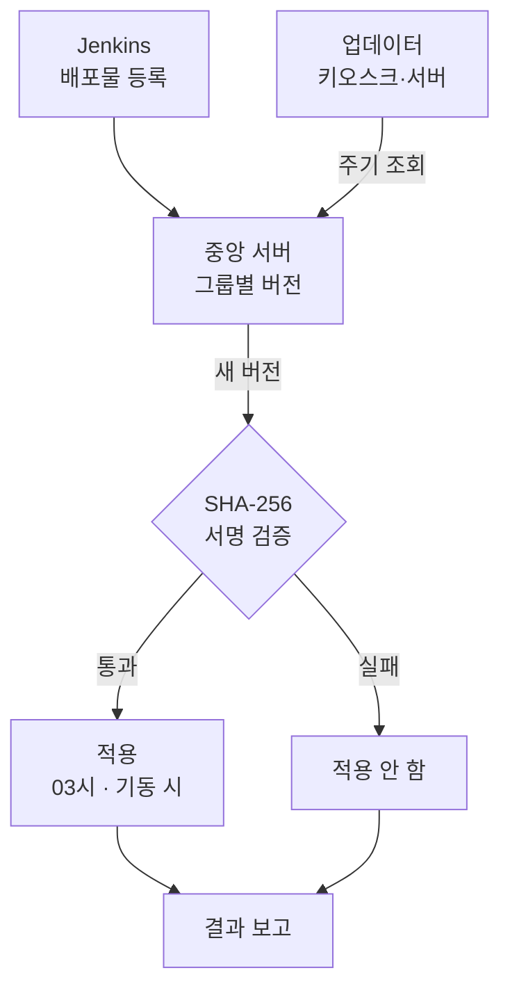

# 북메이트 — 도서관 무인 추천·정보 키오스크 플랫폼

> **2024.01 ~ 재직 중** | **공동 개발 (백엔드 2인)** | 8개 저장소 / 본인 커밋 약 395건 (전체의 약 32%)
> **도입 30개 도서관 · 키오스크 65대 · 일평균 약 2,700건의 키오스크 이용·추천 조회 처리**



*원격 패치 배포 흐름 (2026.10, 본인 설계·구현)*

## 담당 범위

| 영역 | 담당 | 내용 |
|---|---|---|
| 서버 기능 | **본인** | 문학상 수상작 도메인, 도서관 이용 통계, 키오스크 관리, SNS 연동 |
| 데이터 전환 | **본인** | YES24 데이터 전환, 성향 분석 추천 재구성 |
| 현장 운영 | **본인** | 설치 자동화, 키오스크 화면 감시, 원격 패치 배포 |
| 인프라·플랫폼 | 동료(팀 리드) | 인프라·CI/CD, 게이트웨이, 서지 데이터 구축 배치 |

인프라·CI/CD·게이트웨이와 서지 데이터 구축 배치는 동료(팀 리드)가 주도했고, 본인은 기능 단위로 참여했습니다.

## 주요 작업

- **문학상 수상작 도메인 개발** — 최근 3개년 문학상 수상작을 수집·제공하는 기능을 API·서비스·문서 계층까지 담당하고, 해당 기능의 **테스트 코드를 함께 작성**
- **도서관 이용 통계 수집** — 인터셉터 기반으로 도서관별 일일 이용 통계를 수집하는 구조를 구현. 비즈니스 로직에 집계 코드를 섞지 않고 횡단 관심사로 분리
- **키오스크 관리 기능** — 키오스크 등록·조회 API 및 도서관별 장비 관리. 도서관 코드·키오스크 키 기반으로 장비별 설정을 분리하고, 설정 누락 시 경고하도록 처리해 **65대 규모 배포에서 설정 오류를 예방**
- **SNS 연동 기능 개발** — 도서 SNS 업로드 컨트롤러·서비스 개발 및 **테스트 코드 작성**
- **다국어 메시지 체계 관리** — 메시지 프로퍼티 기반 응답 메시지 일원화
- **운영 이슈 상시 대응** — 외부 API 스펙 변경, SSL 인증서 문제, 배포 환경 이슈 등

## YES24 데이터 전환 (2026.09 ~ 10)

도서 데이터 출처를 YES24로 바꾸는 작업을 단계별로 나눠 진행했습니다.

- **단계별 전환** — 버전 태그 기반 이미지 배포, 도서 상세 정보 실시간 조회, 키오스크 화면 설정 등을 7단계로 나눠 진행
- **성향 분석 추천 재구성** — 동료가 만든 성향 분석 추천을 YES24 데이터에 맞게 재구성(YES24 분류 → 북메이트 카테고리 매핑, 쪽수·출판연도 계산)
- **추천 버그 수정** — 분류 정보가 없는 도서에 모든 카테고리가 붙던 MongoDB `$lookup` 조인 버그를 찾아 수정

## 설치 이후의 운영 — 화면 감시와 원격 패치 배포 (2026.10)

설치를 자동화한 뒤에도 두 가지 문제가 남았습니다. "65대가 실제로 잘 켜져 있는가"와 "새 버전을 내보낼 때마다 다시 현장 작업이 필요한가"입니다.

- **키오스크 화면 감시** — 키오스크 화면(Chrome)이 꺼지면 감지해 바로 다시 띄웁니다. 재기동까지 걸리는 시간을 **최대 3분에서 약 15초로** 줄였습니다
- **원격 패치 배포** — 중앙 서버에 배포물을 등록하면, 각 키오스크와 도서관 서버의 업데이터가 주기적으로 상태를 보고하며 자기 그룹의 버전을 조회합니다. 버전이 다르면 내려받은 파일의 **SHA-256 체크섬과 서명을 모두 검증한 뒤에만** 적용합니다
- **배포 그룹** — 배포 대상을 키오스크·도서관·전체 단위 그룹으로 지정합니다. 그룹 버전을 낮추면 같은 경로로 롤백되기 때문에 별도 롤백 로직을 두지 않았습니다
- **적용 시점·결과 추적** — 새벽 3시 예약 적용과 서비스 기동 시 적용을 함께 두고, 적용 결과(성공/실패)는 서버로 보고돼 기관 단위로 추적할 수 있습니다

> 아래 코드는 실제 구현을 단순화해 재구성한 예시입니다.

```java
// 내려받은 패치는 체크섬과 서명이 모두 맞을 때만 적용 대기로 올린다
byte[] data = download(release.url());
String actual = HexFormat.of().formatHex(MessageDigest.getInstance("SHA-256").digest(data));

if (!actual.equalsIgnoreCase(release.sha256()) || !verifySignature(data, release.signature())) {
    report(currentVersion, release.version(), "FAILED", "sha256 또는 서명 검증 실패");
    return;
}
stageForApply(data, release.version());
```

## 현장 설치 자동화

설치를 직접 맡으면서 만든 설치 자동화 체계를 추천 시스템과 AI 미들웨어에도 적용했습니다. 자세한 내용은 [현장 설치·배포 자동화](05-install-automation.md) 문서를 참고해주세요.
