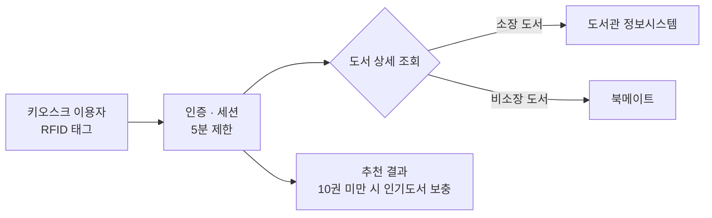

# AI 미들웨어 (북큐레이션) — 도서관 정보시스템 연계 서비스

> **2025.06 ~ 재직 중** | **공동 개발 → 2026.09부터 단독** | 217 커밋 중 본인 110건 (약 51%), 2026년 9월 이후 커밋은 전부 본인
> **2개 기관**에 적용 · 도서관 정보시스템과 연계해 개인 맞춤 도서 추천·인증을 제공하는 미들웨어



핵심 개발자는 동료였고, 본인은 **인증 영역과 북메이트 연계 기능을 담당**하다가 이후 **설치·배포 관리 전반을 인수**했습니다. 2026년 9월부터는 핵심 개발자 없이 **모든 기능 개발을 단독으로** 이어가고 있습니다.

## 단독 개발 이후 (2026.09 ~)

- **본사 연동 구조** — 미들웨어가 처리한 호출 로그와 체크인 정보를 본사 서버로 보내고, 키오스크 API Key를 본사에서 받아 검증하는 구조를 만들었습니다. 여러 기관의 키오스크 상태를 중앙에서 볼 수 있는 기반입니다
- **LLM 추천 리포트 정제** — 동료가 만든 AI 추천 리포트를 화면에 넘겨주는 API를 추가하고, LLM 출력에 남아 있던 HTML 엔티티·마크다운 서식·줄바꿈·글자 수 표기 등을 JSON 트리를 순회하며 제거하는 정제 로직을 설계했습니다 (단위 테스트 포함)
- **운영 기능** — API 키 인증·접근 로그 필터, 알림톡 발송 Rate Limiter, 북메이트 연동 경로 통일(로그인 통계 중복 전송 방지), Jenkins/Docker 배포 파이프라인

## 초기 담당 업무 (2025.06 ~)

- **RFID 로그인 방식 도입** — 도서관 회원카드 RFID를 이용한 인증 방식을 추가해, 키보드 입력 없이 카드 태그만으로 로그인 가능하도록 구현
- **인증·세션 보안 강화** — 로그인 암호화 검증 로직 수정, **세션 유효시간을 5분으로 제한**하고 세션 쿠키 정책 설정. 공용 키오스크 환경에서 이전 이용자의 세션이 남지 않도록 하는 것이 목적
- **북메이트 연계 기능** — 기관 수상 추천 도서 연계, 도서 상세 정보 제공(**소장 도서는 도서관 데이터, 비소장 도서는 북메이트 데이터**로 분기)
- **추천 결과 보정** — 개인 맞춤 추천 결과가 10권 미만인 경우 인기 도서로 보충해 **결과가 비어 보이는 문제를 해결**
- **API 문서화** — 로그인·인증, 개인 맞춤 추천, 작가 도서 추천, 기관 수상작 추천에 대한 Swagger 명세 작성 (401 응답 예시 포함)
- **로깅 체계 구성** — Logback 기반 로그 파일 저장 설정 추가

### 예시 코드 — 추천 결과 보정

> 아래 코드는 실제 구현을 단순화해 재구성한 예시입니다.

```java
public List<Book> getPersonalizedRecommendations(String memberId) {
    List<Book> personalized = recommendationClient.fetch(memberId);

    if (personalized.size() < MIN_RECOMMENDATION_COUNT) {
        // 결과가 비어 보이지 않도록 부족분을 인기 도서로 보충
        List<Book> popularBooks = popularBookService.getTopPopular(
                MIN_RECOMMENDATION_COUNT - personalized.size());
        personalized = Stream.concat(personalized.stream(), popularBooks.stream())
                .distinct()
                .toList();
    }
    return personalized;
}
```

## 설치·배포 체계 인수

핵심 개발자가 아니었음에도 설치 관리 담당을 맡게 되어, 기존에 산재해 있던 설치 자료를 정비하고 Linux 설치 스크립트 8종을 단독으로 작성했습니다. 자세한 내용은 [현장 설치·배포 자동화](05-install-automation.md) 문서를 참고해주세요.
